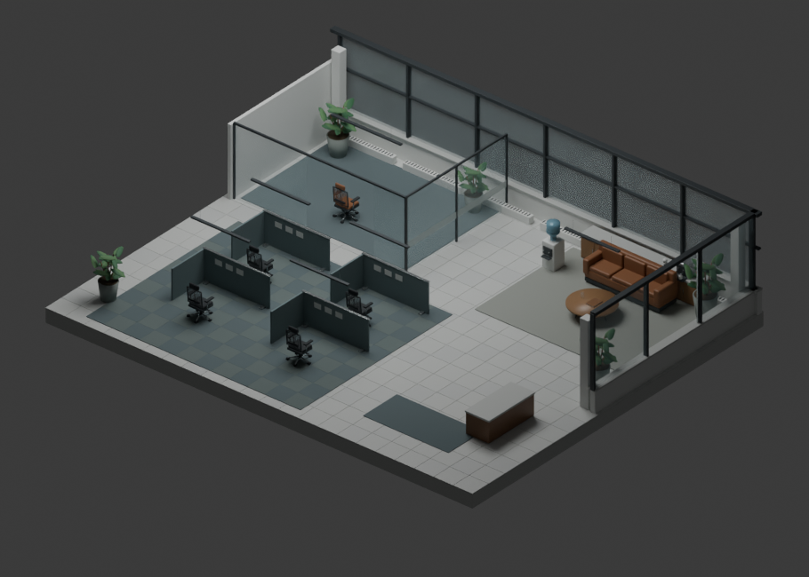

# Iteration1

A spatial workspace for AI-assisted software development. A **workspace** is a working set of projects. Each project is a **cloud** on that workspace’s sky; zooming into a cloud opens the agents, tickets, and desks for that project only. Agents run on **Codex** or **Claude**, side by side, and Cursor sessions can join too.



## Cloud workspaces

There are two layers here, and they are easy to mix up.

**What is live** is a local workspace sky in the companion. Pick a workspace, see only that workspace’s projects as clouds, zoom into a cloud to open its project page. Codex, Claude, Cursor, tickets, and pairing all still run against those desks.

**What is not live** is sharing those workspaces — a shared drive crossed with Slack, with invites, per-project access, and search. That contract lives in `src/cloud/` so sharing and search can be built against one shape. Do not route companion traffic through it.

Why the city went away: the office-block downtown put every checkout in one implied neighborhood. An unrelated side quest looked like a neighbor, and there was no way to keep one working set on screen. A workspace is that working set.

### The live sky

The left rail lists your workspaces, as in Slack or Discord: one circle each, with a badge counting agents working there. Click one to enter it; right-click to rename it, change or remove its picture, or remove it. **+** creates a workspace. A workspace is a real record on saved state (`state.workspaces` in `.office/state.json`), each room has a `workspaceId`, and the sky only shows that workspace.

The sky is a 2D canvas with parallax layers, painted for the local time of day (`?hour=19` previews another hour). Each project is a simple vector cloud:

- **Your projects** sit in front in a tight cluster, with a light yellow band along the base. **Projects shared with you** sit on layers further back and come into focus as you zoom toward them. For now these are placeholder projects from `src/cloud/seed.json`.
- Every cloud shows its title; a cloud is sized to its title, so the title always fits. Zooming in shows the description and the agents, drawn as small blob people colored by type (the legend is bottom right). Your clouds show these at the home view.
- Drag, swipe or use the arrow keys to move; pinch or scroll to zoom. Zoomed out, clouds pack closer together. Click a cloud to go to it. Zooming into one of yours fills the screen with white and opens its office; press Esc to return. The office's **Document** view shows the project as a page.
- Bottom left: **Home** returns to your projects, and **Sky | Folders** switches to a folder view of every project as a card.
- The search bar is a placeholder that matches names and descriptions; semantic search replaces the matching. **Only show my projects** hides everyone else's clouds.

Older save files have no workspaces. On load, `initWorkspaces` in `server/workspaces.mjs` gathers every existing room into **My workspace**, so nothing disappears. Saved state stays `version: 1` and is migrated in place: bumping the version would make the server reject the file and reseed, which would destroy existing projects. Removing a workspace moves its projects to another one; the last workspace cannot be removed; there is a cap of 24.

Files to touch: `src/sky/` (the sky: `SkyView.tsx`, renderers, shaders, time of day), `src/WorkspaceRail.tsx`, `src/ProjectDoc.tsx`, `src/App.tsx`, and `server/workspaces.mjs`. Routes: `GET/POST /api/workspaces`, `PATCH/DELETE /api/workspaces/:id`, `POST /api/workspaces/:id/rooms`, `POST /api/rooms/:id/workspace`. [Why the sky replaced the city](docs/architecture.md#why-the-sky-replaced-the-city).

### Hidden sky looks: ask before deleting

Other looks for the sky are kept in the code but hidden from the interface. Each still opens from the address bar:

| Address | Look |
| --- | --- |
| `?sky=balloons` | Projects as hot air balloons in a 3D sky you can fly through (`src/sky/renderer-balloons.ts`) |
| `?sky=clouds3d` | The vector clouds in 3D (`renderer-vector.ts`) |
| `?sky=soft` | Soft, fluffy 3D clouds (`renderer-3d.ts`) |
| `?sky=2d` | Soft clouds on a flat canvas (`renderer.ts`) |

**Before the final deploy, ask the team whether to delete these for good**, the balloon view especially. Nothing depends on them. The 3D camera and puff-cloud code in `renderer-3d.ts` is shared by the balloon and 3D views, so delete those together.

### Shared access (planned)

The access model below is the contract for joining and sharing. It is not wired to the live sky.

- **Workspaces** there are company or public worlds joined by invite or email. Nothing is shared or searchable across them.
- **Projects as clouds** would show your active work in front and other people’s visible projects as faint background clouds.
- **Share links** would open a project document for people with access.
- **Work still runs locally.** Each person runs their own agent on their own account and computer; a future host stores and shares projects, it does not run agents.
- **Copying an agent** would take name, role, instructions, skills, tools and engine, never history or the project’s code.
- **Search** comes later: find agents and projects in your workspace that do similar things.

Each project has a default level for everyone in its workspace, and the owner can share it with individual people, as in Google Docs. A person gets the higher of the two, with each switch on if either has it on.

| Level | Can |
|---|---|
| None | See nothing: the project is not on the canvas or in search, and its share link refuses |
| Viewer | See the name, description and agents |
| Commenter | View and comment |
| Collaborator | Comment, run agents and upload work |
| Owner | Everything, plus sharing and transferring ownership |

Two switches apply to viewers and commenters: **code and history**, and **copy agents**. Collaborators and owners always have both.

`src/cloud/model.ts` defines that shape and `accessFor()`. `src/cloud/seed.json` is placeholder data (two workspaces, 18 projects, 29 agents, including projects hidden from the signed-in user). `src/cloud/data.ts` loads it. Change those files if you are working on sharing or search. The running sky uses `server/workspaces.mjs` and `state.workspaces`.


## Run locally

Requires Node.js 20.19+ and npm. Live agent work needs at least one engine: a ChatGPT account for Codex, or an Anthropic API key for Claude.

```sh
npm ci
npm run dev
```

Open **http://127.0.0.1:4314**. For a production build, run `npm run build`, then `npm start`.

The sample office works without signing in and is explicitly simulated. For live work, connect an engine from the top bar and choose an existing local project folder:

- **Codex** signs in from **Connections → Codex**. It installs the pinned Codex CLI into the project if it is missing, then opens ChatGPT sign-in in your browser; the page continues on its own when you finish, or you can paste its localhost callback URL. Iteration1 uses its own sign-in profile in `~/.iteration1/codex`; it does not switch the Codex desktop app's account. Account model availability and usage limits apply.
- **Claude** connects from **Connections → Claude**: sign in with Claude into an app-owned profile, or paste an Anthropic API key, which is checked with Anthropic and saved only on this computer.
- **Cursor**'s SDK creates a dedicated app key from **Connections → Cursor**.

Provider accounts connect through the browser without importing a local CLI login. [Connection steps, credential storage, and deployment boundaries](docs/provider-connections.md).

On Windows, `npm run runtime:install` installs the pinned project-local Codex runtime. Restart Iteration1 after installation. Complete Windows sandbox setup from the connection panel before starting work if requested.

## Use it

1. **Pick a workspace, then a project.** Choose a workspace in the left rail; its sky shows your projects up front and projects shared with you behind. Click or zoom into one of your clouds to open its office; press Esc to return.
2. **Describe the work.** Start work applies a reusable workflow. Choose the **Manager model**, from Codex or Claude. The manager delegates bounded research and review for substantial tasks and remains the implementation owner. A new ticket can also stay in the backlog without running a model.
3. **Follow the project.** The expanded view is still the office desks: published progress, commands, changes, and task state. The sidebar keeps tickets, agents, start work, connections, and settings next to that view. Private reasoning is not displayed.
4. **Coordinate.** Handoffs connect findings to assignments. Declared file scopes and dependencies help sequence work. Pair a teammate's office to exchange status and context across separate checkouts.
5. **Inspect the result.** Open the diff, recorded checks, and feature URL. Verification requires acceptance checks and evidence; an agent's completion message alone is insufficient. The feature's development server must remain running.

Replacing an agent preserves its task and handoff. Development modes adjust the next turn's model policy, reasoning, concurrency, and time budget. Checkpoints support inspection and branching; they are not a substitute for Git review.

## Team offices

Each participant runs Iteration1 with their own checkout and account. **Team** creates or accepts a short-lived invitation. Pairing shares assignments and explicit handoffs; it does not synchronize files or merge branches.

The current transport supports **one real paired teammate per project**. The visual district supports nine offices with selective interior detail; the **+** control adds local visual previews, not authenticated teammates. [Connection guide and limitations](docs/team-offices.md).

To rehearse two connected offices without model calls:

```sh
npm run build
npm run demo:team
```

Open **http://127.0.0.1:4351** and **http://127.0.0.1:4352**. Pair Alex and Blair through Team using the loopback address. These offices use test agents and real HTTP transport, clearly labeled in the UI.

## Controls

| Control | Action |
| --- | --- |
| Drag / swipe / arrow keys on the sky | Move around |
| Pinch / scroll on the sky | Zoom toward the cursor. Zooming far into one of your clouds opens that project |
| Home (bottom left) | Back to your projects |
| Esc / zoom out | Leave a project and return to its workspace sky |
| Overview / Map / Walk | Change the expanded project view |
| WASD / arrows | Move in walk mode |
| E | Inspect the focused desk |
| Sidebar | Tickets, agents, start work, connections, settings, plus handoffs, team, Inbox, history, and tools |

Tools includes workflows, skills, Cursor & Claude setup, development modes, and presentation controls. The recording studio selects camera stops and a clean view; it does not record video.

## Cursor and skills

The `.cursor/mcp.json` configuration and `/office` command connect an existing Cursor session to Iteration1. Cursor controls its own execution and permissions. Reports are marked as reported evidence and cannot automatically verify a task. No separate provider API key is needed by this integration.

**Sign in once** from the Cursor panel to give your sessions a durable desk, a name that persists across runs, and a track record. Iteration1 uses Auth0 with Authorization Code and PKCE: it opens a browser tab, you authenticate, and the redirect lands back on loopback. Tokens stay in ignored `.office/` storage, so nothing secret belongs in `.cursor/mcp.json` and the MCP server holds no credential at all. Work still runs signed out, but publishes unattributed.

Connect a tenant once in the panel, or set `ITERATION1_AUTH0_DOMAIN` and `ITERATION1_AUTH0_CLIENT_ID`. Use an Auth0 **Native** application, which is a public client with no secret, and allow `http://127.0.0.1:4314/auth/callback` as a callback URL.

Iteration1 can also **launch** a Cursor agent itself through the Cursor SDK, as an alternative to a session reporting in. Those runs use a model chosen here, stream their observable work, and can be stopped from the office. Set `CURSOR_API_KEY` first; launching requires Node 22.13+, which the rest of the app does not.

## Codex CLI sessions

A **Codex CLI** session you run yourself can report into the office over MCP too, on its own ChatGPT sign-in, which stays separate from the office's Codex profile. Open **Connections → Codex → Use an existing Codex CLI session**, copy the connect command (it runs `codex mcp add` and points the server at that project), then copy the start command. Its desk tools are `office_codex_start`, `office_codex_update` and `office_codex_finish`; reports are labeled `codex-reported`, and it shares the per-project writer lock with Cursor and Claude Code.

## ASI:One (Fetch.ai) agent


**iteration1-office** (`agent1q0r5evneykvtpltu348zc0nq6a32lwuaq4ywjt0twxw7kz9945y0qgxn6mk`) lets the office's owner run it from an ASI:One chat. It is a uAgent that implements the Agent Chat Protocol and is registered on Agentverse. Say `status` for tasks, blockers and who is working, `report on <task>` for a run doc that separates verified receipts from self-reported ones, `approvals` for commands waiting in the office, `alerts` for what the watcher noticed, or `mission: <what to build>` to hand a new mission to the implementation manager, followed by `confirm`.

It is another client of the local office, like the MCP servers. It runs on your computer and reaches Agentverse through its mailbox, an outbound connection, so the office stays on loopback and the agent's own server listens only on `127.0.0.1`. It holds no office credential, and missions publish under the account signed in to the office.

- **Pairing.** Only paired sender addresses can use it. At startup the agent prints a single-use code in its terminal; send `pair <code>` from ASI:One. Pairing locks after five wrong codes until restart. Paired addresses and the agent's generated seed are kept in `.office/fetch-agent.json` (git-ignored). To check whether ASI:One gives each user their own sender address, chat from a second ASI:One account: the terminal logs each sender, and that account should be refused. The code is accepted anywhere in a message as its own word, since ASI:One may reword what you type, and the terminal logs the first 200 characters of every message it receives. To check pairing without ASI:One, run `agents/pair_test.py <code>` with the agent running: a second, local uAgent sends `pair <code>` and `status` and prints the replies. It stays paired until you remove its address from `.office/fetch-agent.json`.
- **Limits.** Missions need an explicit `confirm` within ten minutes. Command approvals, stopping agents and pausing stay in the Iteration1 app; the agent cannot approve anything. Chat text and office content are treated as data.

```sh
python -m venv .office/runtime/agent-venv
.office/runtime/agent-venv/Scripts/python -m pip install -r agents/requirements.txt   # bin/python on macOS and Linux
.office/runtime/agent-venv/Scripts/python agents/office_agent.py
```

With the office running (`npm start`), open the `agentverse.ai/inspect` link the agent prints and choose **Connect → Mailbox** once. On Windows on ARM, uAgents needs `grpcio`, which has no ARM64 wheel; create the venv from an x64 Python (for example the `python` NuGet package unpacked under `.office/runtime/python-x64`), which runs under emulation. Tests: `python -m unittest discover agents`.

**iteration1-watcher** is a second, local uAgent that follows the office's live state stream and tells the office agent, agent to agent, when a task blocks, becomes ready for review or finishes (with whether it was verified), when an approval is waiting, when a new mission starts and when the office pauses or goes offline. The office agent forwards each batch to its paired owners in ASI:One and keeps the last 20 for `alerts`, in case a message the agent starts doesn't appear in the chat. The office agent accepts alerts only from the watcher whose seed sits beside its own in `.office/fetch-watcher.json`. The watcher reconnects with backoff when the office restarts, compares against the last state it saw so nothing is missed meanwhile, and drops repeats within a minute. Run it beside the office agent:

```sh
.office/runtime/agent-venv/Scripts/python agents/watcher_agent.py
```

## Claude agents

Claude agents are full office members, run through the Claude Agent SDK. Choose a Claude model (Claude Opus 5.5, Sonnet 5.5, Haiku 5.5 or Fable 5.1) as the manager when you start work, or when you replace any agent, and the office runs exactly as it does on Codex:

- **Same roles and permissions.** The manager is the only writer: it edits files and runs commands in an OS sandbox that confines writes to the project folder, and the run fails instead of running unconfined if that sandbox is unavailable. Workers are read-only. A **Read only** office keeps every Claude agent read-only.
- **Same coordination.** Claude agents use the office tools Codex agents use (delegate, status, handoffs, acknowledgements and ticket updates), served to Claude as MCP tools by the same implementation. A Claude manager delegates to Claude workers; Crunch and Economy modes give workers Claude Haiku 5.5. Finished workers hand off to the manager, and messages and handoffs reach a Claude agent mid-turn.
- **Same evidence.** Commands and file edits are recorded as observed evidence: test commands with the project version they ran against, and edits as a project diff. Plans published with TodoWrite show as the desk's plan. Development modes set Claude's effort and the turn time budget.
- **Continuity.** A Claude agent continues its own conversation across turns and restarts; sessions are kept in `~/.iteration1/claude`, apart from your own Claude Code history. It can be stopped, steered and replaced like any desk.

Claude agents run on the Claude account signed in from **Connections → Claude**, or on an Anthropic API key pasted there. The key is saved only on this computer (`~/.iteration1/anthropic-key.json`, readable only by you) and never sent back to the page. `ANTHROPIC_API_KEY` in the environment also works and takes precedence. Usage follows that account's or key's billing and limits. Claude agents do not use Codex approval prompts or fast mode.

**Claude Code sessions connect over MCP, with no API key.** An existing Claude Code session reports into the office the same way a Cursor session does, using your own Claude sign-in and model. In this repository the checked-in `.mcp.json` and `/office` command are all you need: open Claude Code here, approve the `iteration1` server, and run `/office`. For another project, open **Connections → Claude** and copy the connect command, which runs `claude mcp add` with project scope, then copy the start command to open Claude Code with the office prompt. The desk tools are `office_claude_start`, `office_claude_update` and `office_claude_finish`, alongside the shared `office_open`, `office_status`, `office_identify`, `office_run_doc` and `office_dispatch`. Cursor and Claude Code share one writer lock per project, Claude Code reports are labeled `claude-reported` (self-reported in run docs), and they publish under the Auth0 account signed in to the office. Like Cursor, the office observes a Claude Code session but cannot stop it.

Reusable manager, handoff, and review skills live in `skills/`. The app can install them into a project's `.agents/skills` without overwriting differing instructions.

## Validation

```sh
npm test
```

The test command builds the production assets first because the API tests exercise the production server.

Tests cover lifecycle, delegation, dependencies, evidence, permissions, model replacement, checkpointing, paired-office transport, one-click Codex sign-in, and Claude office agents using isolated deterministic test adapters for Codex and the Claude Agent SDK. They do not establish live model quality or headset performance.

`examples/project-starter` is a small React starting point. `examples/project-result` preserves a completed agent-built feature, with its own tests and setup. [Architecture and execution boundaries](docs/architecture.md). The Convex backend and env host are in [docs/backend.md](docs/backend.md).

## Local data

State, checkpoints, and pairing credentials remain in ignored `.office/` storage. The app listens on loopback and validates requests. The separate team listener exposes only pairing/status/handoff operations on a trusted network; see the team guide before connecting. Do not expose the execution API publicly.

Optional configuration: `PORT`, `OFFICE_DATA_DIR`, `OFFICE_CODEX_HOME`, `OFFICE_CODEX_BIN`, `OFFICE_CODEX_ARGS`, `OFFICE_TEAM_PORT`, `ANTHROPIC_API_KEY`, `OFFICE_CLAUDE_HOME`, `OFFICE_CLAUDE_KEY_FILE`, and `OFFICE_CURSOR_AUTH_FILE`. Credentials are never part of this repository.

## Assets and VR

The default shell is the workspace sky (`src/sky/`), drawn with three.js on a flat canvas. The city and district metaphor is no longer the starting view; those objects stay in the renderer for team and recording paths but are hidden on the sky and on a normal project open. The office geometry is still the expanded project. The runtime model is included at `public/models/office-shell.glb`; asset provenance is in `assets/`. Blender is optional for authoring and is not started by the app. From the repository root, an explicitly launched Blender session can run `scripts/build_office_assets.py`; `ITERATION1_ROOT` overrides its output root. That script replaces the active scene, so use a fresh Blender file.

Workspace membership persists in `.office/state.json`; removing a workspace rehomes its projects instead of orphaning them, and the last workspace cannot be removed. Team-district framing from the sky is unfinished.

Three.js WebXR provides an initial headset path. Headset comfort, controller behavior, and production VR performance are unverified; the supported demonstration is the desktop walkthrough.
